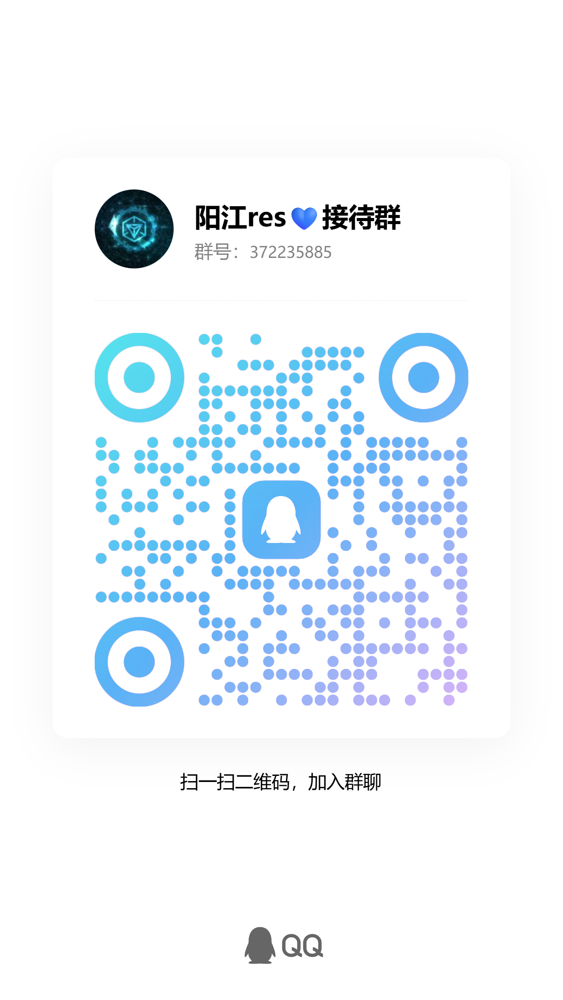

 新人教程以及常用的工具介绍。

<!--more-->

# 新人升级攻略

新人最应该先做的是加入组群，阳江蓝军QQ群:372235885

新手说明文档： **[蓝军汉化Ingress中文新手介绍文档.pdf](蓝军汉化Ingress中文新手介绍文档.pdf)** 

下面文章来自：北京蓝军网站 [Ingress Resistance BeiJing](https://bjres.net/2016/07/13/%e6%96%b0%e6%89%8b%e6%94%bb%e7%95%a5%e7%b4%a2%e5%bc%95/)

新人刚刚注册完成, 首先做完游戏自带的训练, 了解游戏的基本玩法, 这时候, 就可以愉快的从家中走出, 开始你自己的现实生活中的大冒险了.

等级1 ~ 3:  这是熟悉游戏的阶段, 这一阶段, 你可以看到白po就占, 看到没插满脚的蓝po就插脚插满, 看到绿po就也不要放过, 入侵或者画图一发. 有绿mod也随手插,能link就随意link.也许你会发现你周围有很多绿po, 但是这个阶段的道具还不强力, 打不掉高级的portal. 但是不要担心, 等你成长之后, 凭借你一个人的力量, 你就能让你那一整片区域充满蓝色.

也许你也会碰到其他的Agent, 收获到<初次面基>成就. 蓝军一直有个传统, 新人从第一个面的老玩家那里会得到神秘大礼包一份.

这一阶段, 作为在帝都的玩家, 有一个很大的优势就是白po很多, 它们都等待着你去占领, 你也不用担心升级的问题了. 一边熟悉游戏一边玩, 两三天就可以升到Level4. 其实还有更快的办法, 就是找到一名教练或者老玩家带, 一晚上可以直接带到5级, 但是同样也会少了很多探索的乐趣. 其实自己升到3级, 也可以享受升级的乐趣. 有问题参阅本攻略的FAQ部分.

等级4 ~ 6: 这时候的xmp和us都有了一定威力, 可以破坏掉敌方的没有插盾的portal了. 同时, 你可以开始尝试不同的玩法, 比如是在你熟悉的位置发现不同的风景, 还是在城市中到处闯荡, 可以跟着教练学习如何连多重, 也可以尝试如何创建更大更远的link和field. 这个时候, 如果有时间, 够勤奋的话, 一天升一级是没问题的.

等级6 ~ 8: 这时候的你, 已经有了战斗力, 可以去独自清理掉一片field啦! 你可以像一个猎人一样在iitc上暗中观察, 哪里会有比较密集的绿field呢? 看到猎物出现之后立即赶赴到现场, 经过一番战斗, 将它拿下. 看着在绿field破掉的那瞬间一个很大的ap的数字从屏幕中跳出, 这感觉想必是相当棒的!

哪里有绿军就去哪里! 一般来说, 798, 红领巾公园, 学院路各大高校, 牡丹园, 双榆树, 万柳, 清华, 都是po很密且有绿军出没的. 或者说北京的各个高校,公园等都适合去拿ap. 对于有足够战斗力的你来说, 度过这一阶段, 一周足矣!

等级8: 终于走出了新手村, 来到了更广阔的天地. 我们的口号是: ingrechi! 没事就起个8, 做做任务拼图, 画画field art, 玩一玩蓝水晶蓝竹笋, 参加各种活动, 四处开饭, 整个中国, 或者说在世界各大洲乱窜。

# FAQ

- ***\*什么是ingress?\****

这是一款由Niantic Labs开发的AR游戏, 它基于现实的地理位置而进行, 它强调的是两大阵营的对抗

游戏主页: [https://www.ingress.com](https://www.ingress.com/)

建议先做做游戏界面右上角目录里的训练，然后看看bjres.net的视频教程（不注册也能看），然后可以读读微信公众号ingressbeijing里面的教程

 

- **现在可以申请po吗?**

可以. 但是需要升级到 L10，po 申请的审批工作同样由玩家完成，所需等级为 L12

- **如何看自己的等级和经验(AP)?**
- **什么是XM?**

在游戏中, 几乎任何行动都要消耗XM. 可以通过走来走去吸取地上的XM或者使用power cube进行补充

http://decodeingress.me/ingress-manual/exotic-matter-xm/

(根据剧情, portal是连接到另外一个世界的传送门, 神秘物质从时不时的传送门中大量涌出, 所以portal附近地面上会充斥着大量的XM)

- **什么是portal?**

Portal, 中文版翻译为据点, 是这个游戏中蓝绿双方争抢的对象.

为一个Portal插上第一只Resonator 就会占据它.

(黑话: portal经常被称作po或者塔)

- **什么是入侵(Hack)?**

Hack, 中文版翻译为入侵, 在portal界面点击入侵就完成了一次入侵.

在Ingress中, 入侵是最主要的获取物资的手段. Resonator, XMP, Key,Power cube, Mod 等都是通过入侵来获取的.

Tips: 可以入侵蓝po! 入侵动作不会对己方po造成任何损害,所以不用担心!

Tips: 入侵己方portal无AP, 入侵敌方portal 有100AP, 但是入侵敌方po会因为敌方po的攻击而损失XM.

(黑话: hack又称摸po.hack还有数种隐藏模式! 下文会说到)

- **什么是画图(Glyph Hack)**

画图是一种隐藏模式, 长按portal的入侵(Hack)按钮, 就会出现一个有着很多个点的界面, 正确的画出系统随机出现的图形, 会得到更多的物资和更多的AP.

(黑话: Glyph hack又被成为鬼画符, 画鬼符等)

https://fevgames.net/ingress/ingress-guide/actions/glyph-hack/

1. - 每一个图形都有它的特定含义, 关于如何记住它们, 可以参见蘑菇的Glyph 攻略

http://wtoutiao.com/p/F71x3M.html

1. - Command line

在长按入侵之后迅速输入命令可以起到不同效果.目前有四种:

- More: request key
- Less: no key
- Complex: 加快速度
- Simple: 降低速度

 

- **po过热/烧毁是什么意思?**

过热(Running hot): 入侵同一个po有时间间隔, 入侵过之后要等待五分钟才能再次入侵,

烧毁(Burn out): 每4小时中, 同一名玩家只能入侵同一个po4次. 烧毁之后要等待四小时(从第一次摸po算起)

有其他道具可以缩短cold down的时间(heat sink), 和增加每4个小时的hack 次数(multi hack)

Tips: 过热和烧毁都只针对一个玩家和一个po, 不影响其他玩家或者其他po

- **什么是resonator?**

Resonator 谐振器, 在游戏背景中, 它会为portal提供能量, resonator的能量越高, 那么这个portal的能量也越高.当没有任何谐振器的时候, portal就处于未激活状态, 呈现为灰白的颜色. 每一个portal最多有8个resonator. portal的等级就等于resonator的等级和除以8.

如何插脚: 在portal界面, 点击放置.

Tips: 每一次入侵都会得到resonator, 所以不需要刻意节省, 能插就插.

Tips: 为po插第一只脚有625 ap (即普通差脚的125ap + 占据portal的500 ap) 相当可观, 所以小伙伴们要多多占白po哦!

(黑话: resonator 又称脚或者电池, 所以放置谐振器又称插脚.

你们有没有觉得一个有着8条连线的portal很像有八只脚的八爪鱼呢?)

- **充电是什么?**

点开portal界面的recharge, 可以为脚的能量不满的己方po进行充能.

(黑话: recharge, 又称为充电)

- **掉电是什么意思?**

每天po的脚都会自动掉15%的能量, 如果不充电, 一周正好掉完, po就重新变白了.

- **什么是key? Key能做什么?**

入侵有几率(大约75%)获得key.

Key可以用来做link 或者给portal远程充电.

- **如何获得key? 为什么总是拿不到更多key?**

当你没有key的时候直接点入侵会有75%左右几率获得key

但是如果已经有key了再点入侵则不会获得key

要想获得更多key, 需要在画图界面输入more, 或者把已有的key装在桶里.

Tips: 装在桶里的key 无法使用

- **什么是link?如何link?**

两点成一线. 站在当前po上, 在当前po的界面中点击link, 选中目标po, 就会创建一条连接两个po的线.

Link需要条件:

- 当前的po在你的触摸范围之内(45米)
- 当前po和目标po都插满了8个脚
- 拥有目标po的key 并且key不在桶里
- 当前po和目标po之间无交叉link
- 当前po没有达到射出上限(一般是8条)
- 当前po不在field内部

 

- **什么是control field(控制场)?**

三条首尾相连的link可以组成三角形, 就是一个control field, 简称field.

在游戏背景中, control field可以用来捕获mind unit, 而mind unit的大小直接关系到全球的蓝绿比分, 也是游戏的目标所在. MU的数值和field面积以及现实中的人口密度都是正相关的.

http://decodeingress.me/ingress-manual/control-fields/

- **什么是多重**

https://zhuanlan.zhihu.com/p/19579305

把一片密集的po清干净并且连多重, 是很效率的升级方式, 仅次于炸掉敌方的多重, 但是后者可遇而不可求.

- **什么是XMP**

主要的进攻性道具, 可以破坏范围内的敌方脚的能量. 以玩家当前所在的位置为中心, 距离越远, xmp威力越小.xmp的范围可以点击道具查看. 当敌方的portal的脚的能量全部掉光之后, po就变成白色的未激活状态, 就可以占据它.

Tips: 在地图上随便找个点按住, 就会出现fire xmp选项, 就不需要去道具中找到它们然后再发射了

- **什么是power cube**

用来补充XM的道具, 回收可以一次性使用多个, 可以快速回满xm.

在fire xmp的界面上也可以使用power cube来补充xm.

- **什么是mod?**

Mod也翻译为强化装置.

- Portal shield: 盾, 增加po的脚的防御
- Link Amp: LA, 增加可link的长度, 同时在玄学中可以用来给友军(鸭王)上祝福, 进行毕业典礼(误).
- Softbank Ultra Link: 又称sbul或者sb, 增加射出link数, 以及可link长度和link的防御. 同时在玄学中可以用来给鸭王上更高级的祝福(最高级的祝福是vr la, 但是笔者也没有那种运气可以见到它呢..)
- Heat sink: hs, 减少po的冷却时间
- Multi hack: mh, 增加四小时内hack次数
- Force Amp: 刺, 增加反击力度
- Turret: 棍, 增加反击频率

 

- **什么是us**

Us是威力强大但是范围很小的攻击性道具, 主要为了卸掉portal上的盾, 或者定点打击某个脚.

Tips: 使用us一定要走到portal的最中心, 让代表你自己的那个小三角的中心和portal的中心点重合是最好的. 但是是否能破盾终究是玄学.

- **AP数量?**

占据一个po有625 ap

插最后一个脚有375ap

插其他脚有125a

插一个mod有125ap

给脚升级有65ap

充电一次有10ap

建立一个link有313ap

建立一个field有1250ap

摧毁敌方的脚/link/field得到 60%的ap

- **升级所需AP?**

http://decodeingress.me/ingress-manual/leveling/

- **做任务有什么用?**

强调一下, 做任务是没有额外ap奖励的! 做完任务得到的只是agent界面上的任务图标.

但是有很多很好看的拼图任务, 等待你去发掘.

Trello上汇总了国内的大部分拼图:

https://trello.com/b/LvwOjrYP/ingress-medal-arts

- **如何申请任务?**

7级以上玩家可以申请任务, 申请任务的网址如下

https://mission-author-dot-betaspike.appspot.com/edit

一些制作工具:

http://www.giacintogarcea.com/share/missionset/

http://medals.ingressmissions.info/slicer.php

- **游戏内有地图吗?**

没有, 但是在官网上有intel

https://www.ingress.com/intel

- **有关iitc**

Iitc就是对intel的显示方式做了美化.

浏览器插件: http://iitc.jonatkins.com/

IOS和安卓也有下载

另外, 现在不会因为正常使用iitc查看po等而封号的!

 

# Mod功能和具体参数

 

Portal Shield

http://decodeingress.me/ingress-manual/ingress-items/portal-mods/portal-shields/

Link Amp:

http://decodeingress.me/ingress-manual/ingress-items/portal-mods/link-amplifier/

Heat Sink:

http://decodeingress.me/ingress-manual/ingress-items/portal-mods/heat-sink/

Multi hack

http://decodeingress.me/ingress-manual/ingress-items/portal-mods/multi-hack/

Force Amp:

http://decodeingress.me/ingress-manual/ingress-items/portal-mods/force-amplifier/

Turret:

http://decodeingress.me/ingress-manual/ingress-items/portal-mods/turret/

Softbank Ultra Link

https://www.reddit.com/r/Ingress/comments/3bxygy/what_is_softbank_ultra_link/
